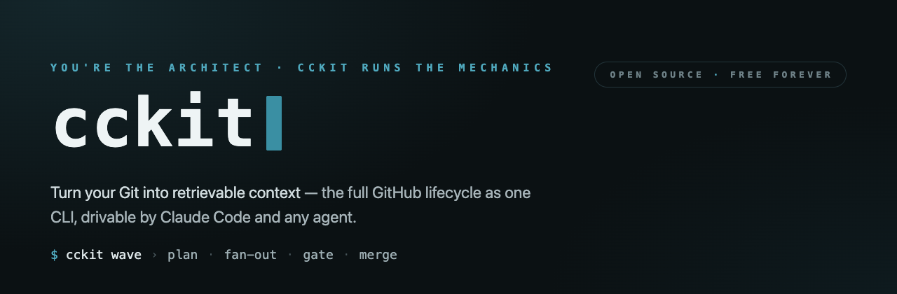

<p align="center">
  
</p>

# cckit

> **You're the architect. cckit runs the mechanics.** The full GitHub work lifecycle — issues,
> worktrees, PRs, merges, multi-agent waves — as one CLI, drivable by Claude Code and any agent.

[](#license)
[](https://docs.claude.com/claude-code)
[](https://cckit.dev)
[](#platforms--requirements)

**[📖 Documentation](https://cckit.dev)** · [The idea](https://cckit.dev/philosophy/) · [Tutorials](https://cckit.dev/tutorials/) · [Quick start](#quick-start) · [Contributing](CONTRIBUTING.md) · [Code of Conduct](CODE_OF_CONDUCT.md)

The whole idea in one line:

> **Turn your Git into retrievable, efficient context** — using issues, GitHub Projects, and other
> people's tools, wired together with a few advanced mechanics.

You bring the ideas and the shape of the thing. The mechanics that make it stand up — branches,
isolated worktrees, PRs, the merge flow, and the trail of issues that says *why* — are what cckit
takes care of. It ships all of that as a single bash CLI plus a Claude Code plugin (skills, rules,
agents), and it is **agent-agnostic by design**: Claude Code is first-class, but any agent that can
run a shell can drive every operation.

## Why

- **One lifecycle, one source of truth.** Start an issue, get an isolated worktree and branch, open
  a PR, merge, and clean up — each step is one command, correct by construction. The board is both
  the plan and the proof.
- **Sessions that pick up where you left off.** `cckit handoff "<note>"` saves a resume-here note;
  bare `cckit` prints it at the start of the next session — context survives the context window.
- **Sessions that talk to each other.** `cckit msg send <branch|project:branch|all> [--steer]
  "<text>"` mails any parallel session on the machine — same project or another; the kit's mail
  hook delivers it to a *live* session between tool calls, and a `--steer` message redirects a
  session that is about to stop.
- **Agent-operable.** Every verb has a machine-readable mode (`cckit <verb> --llm`) and an
  [`AGENTS.md`](AGENTS.md) contract, so agents drive the kit without scraping human output.
- **Scales from one issue to a wave.** The same verbs that take one issue to a merged PR also plan
  and run a whole wave of parallel agents — with a captain that gates and merges behind policy
  floors.
- **Zero hard dependencies.** Pure bash with graceful fallbacks; it auto-detects optional tools
  (`gh`, `jq`, `fzf`, `gum`) and degrades instead of failing.
- **Portable.** No company, framework, or repo is baked in — everything is driven from
  `cckit.config.json`.

## Install

**One-liner (macOS · Linux · WSL):**

```bash
curl -fsSL https://raw.githubusercontent.com/jeiemgi/cckit/main/scripts/web-install.sh | bash
```

**Homebrew:**

```bash
brew tap jeiemgi/cckit && brew install cckit
```

**npm** (the bare `cckit` name is taken, so cckit is scoped):

```bash
npm install -g @jeiemgi/cckit
```

**From source:**

```bash
git clone https://github.com/jeiemgi/cckit.git
cd cckit && ./scripts/install.sh    # symlinks bin/cckit onto your PATH
```

### Platforms & requirements

| Platform | Supported |
| --- | --- |
| macOS | ✅ native |
| Linux | ✅ native |
| Windows | ✅ via WSL or Git Bash (not native cmd/PowerShell) |

Requirements: `bash` 4+, `git`, and `gh` (GitHub CLI) authenticated. `jq` recommended.

## Quick start

```bash
cckit doctor                  # onboarding preflight: deps, gh auth, and each integration you switched on
                              #   asks before installing; with no terminal and no --fix it only reports
cckit init [<folder>]         # guided setup, end to end: names what the folder is, asks what is
                              #   missing, scaffolds cckit.config.json + .claude/, then git + GitHub
                              #   (repository, develop, labels, protection) after ONE confirmation.
                              #   A new project starts from a recipe. See "Set up a project" below.
cckit init --profile software --no-github   # scaffold only: nothing outside the folder
                              #   profiles: software · content · research · automation · minimal
                              #   --adapter claude|codex|both picks the agent (default claude);
                              #   codex writes AGENTS.md + .agents/ and no .claude/ tree;
                              #   both get the commit guards + session-mail hooks (Codex: in
                              #   .codex/hooks.json, merged with yours — trust them with /hooks)
                              #   and one specialist agent per role from the same role source:
                              #   .claude/agents/<role>/AGENT.md and .codex/agents/<role>.toml
cckit add                     # list the optional integrations + modules; `cckit add <name>` switches one on
                              #   `cckit add graft`: code-graph retrieval + the code-retrieval rule
                              #   `cckit add lavish --set enable=no`: turn review pages off (on by default)
cckit page mode               # `page`, or `terminal: <why>` — can this session show a review page?
cckit plan-next               # propose what to build next, grounded in current capabilities
cckit status                  # where are we: next effort per flow, local undone work, PRs to attend, cleanup available
cckit next                    # the next unblocked issue + how to start it + the weekly cadence
cckit start 42                # isolated worktree + branch for issue #42, bootstrapped:
                              #   env files copied, dev port assigned, deps installed at the
                              #   selected targets — worktree.installPaths if set (those dirs
                              #   regardless of their manifests), else a root that declares
                              #   deps or is a workspace root with members, else nothing
                              #   (KIT_WT_INSTALL=0 skips the install entirely)
                              #   refused when another live session already claims #42;
                              #   `cckit start --force 42` (or KIT_FORCE=1) starts anyway
cckit claims                  # which live session is working which issue (read-only)
cckit brief 42                # the delegation brief for #42, read out of the repo not memory
cckit lib                     # every scripts/lib helper: functions, purpose, error contract
cckit pr 42 "what changed"    # commit, push, open the PR
cckit pr 42 "what changed" --base main   # target main, not the integration branch; the push
                              #   exports the target as KIT_PR_BASE for a git pre-push hook
cckit hotfix 268              # cherry-pick merged PR 268 (or a commit sha) onto main (--base B
                              #   for another branch): worktree from origin/main, cherry-pick -x,
                              #   push, PR titled after the source with `Cherry-pick of #268`;
                              #   a rebase-merged PR is carried commit by commit
cckit task new "<title>"      # light tasks: work tracked in tasks/, no GitHub issue —
                              #   task list · task next · task start <id> · task finish <id> "<summary>"
cckit sync                    # board state, what's unblocked
cckit sync --cached 60        # the board as one JSON document, from a cache at most 60s old
                              #   (--json / --write / --watch [secs] / --plan — for a TUI or statusline)
cckit handoff "resume note"   # save a handoff — bare `cckit` prints it next session
cckit gc                      # report prunable branches + worktrees, detached worktrees included (deletes nothing); a failed GitHub read shows as UNKNOWN, kept
cckit cleanup [--yes]         # act on that report: delete the SAFE + LANDED rows, prune listed zombies, keep orphans/stashes
```

Adopting cckit in a repo that already has history? `cckit scan` detects the stack, `cckit adopt`
records kit-shaped files the repo already has, and `cckit status` answers "where are we" — local
undone work, the open PRs waiting on a human, and the cleanup available, plus the board and the
resume handoff in one screen. It ends with the instruction-file line: the bytes `CLAUDE.md` and the
rules without a `paths:` frontmatter put into every session, against Claude Code's 150k limit, and
the three largest files (`cckit doctor` prints the same line; `scripts/instruction-budget-lint.sh`
is the gate behind it). Run `cckit help` for the full verb list, or
`cckit <verb> --help` for any one.

Updating a project an older cckit scaffolded? `cckit update` says whether it is behind (exit 10) and
names the command; `cckit migrate` moves an old layout to the current one;
`cckit init --upgrade --dry-run` runs the upgrade on a temporary copy and prints the files it would
add or modify; `cckit init --upgrade` applies it and prints that same list as `Changed on disk`.
Existing files and every path under `upgrade.removed` are kept, and a version bump alone changes one
line of the config. The path, with what it changes and what it never touches:
[Update a project](https://cckit.dev/update/).


## Set up a project: `cckit init`

`cckit init [<folder>]` takes a folder from whatever state it is in to a project `cckit start` can
work on. It assumes no technical knowledge: it says what it found, asks in plain language, and
every question has one recommended answer.

**1. It names the folder before writing anything.**

| The folder is | What init does |
| --- | --- |
| a git repository with a GitHub remote | scaffolds the kit, then runs the setup steps that are still missing |
| a git repository with no remote | the same, and creates the GitHub repository |
| a project (for example a `package.json`) with no git | the same, starting from `git init` |
| files, but nothing that marks a project | asks: set it up here, start a new project in its own folder, or stop |
| empty, or not there yet | asks whether this is a new project, then what it starts from |
| your home directory, `~/Desktop`, `~/Documents`, `~/Downloads`, `/` | never scaffolds there. Asks whether this is a new project and which folder it gets; with no terminal and no answers file it exits 2 |

**2. A new project starts from a recipe.** A recipe is a JSON file in `recipes/`; adding a file adds
a recipe. One ships: `nextjs-shadcn` (Next.js, shadcn/ui, pnpm). init then asks whether the project
needs a database and offers the options in `databases/`. One ships: `supabase`. It adds
`@supabase/supabase-js` and `@supabase/ssr`, `lib/supabase/client.ts` and `lib/supabase/server.ts`,
and the two variable names in `.env.local` with placeholders. A guide page
(`databases/supabase/guide.html`) shows where to create the Supabase project and where each value
is; init opens it with `npx -y lavish-axi` when a browser is available and prints the same steps
otherwise. You type the values into `.env.local` yourself: cckit never prints or reads them back,
and git ignores the file.

**3. Git and GitHub, after one confirmation.** init lists every step first, then asks once on a
terminal. With no terminal it runs them only with `--yes`; without it the kit files are written and
the run ends by saying the setup did not run.

| Step | Skipped when |
| --- | --- |
| `git init` (branch `main`) and the first commit | the folder is a repository / it has a commit |
| `gh repo create`, private (`--public` for public) | `origin` is set; an existing `<owner>/<name>` is connected instead |
| branch `develop` created and pushed; default branch on a repository init created | GitHub has the branch / an existing repository keeps its default |
| labels and milestones | only the missing ones are created |
| "automatically delete head branches" | already on |
| protection of the base branch: pull request required, branch up to date, linear history, no force-push | already protected. A plan that refuses it (HTTP 403 on a private repository of a free account) is reported as skipped with that reason |
| Projects v2 field ids | the project has no board |
| `cckit doctor` report | never |

Each step prints `done`, `skipped` or `failed`. A failed step does not stop the later ones, and the
run exits 1 after all of them. A re-run skips what is finished: on a set-up project it changes
nothing and every line says `skipped`.

```bash
cckit init my-app                          # guided: answers the questions on a terminal
cckit init my-app --dry-run --recipe nextjs-shadcn --database supabase   # print every step, write nothing
cckit init my-app --answers answers.json --yes   # no terminal: answers from a file, setup confirmed
cckit init --profile software --no-github  # the scaffold alone, as before
```

`--answers` takes a JSON object keyed by question: `new_project` (`yes`/`no`), `folder_use`
(`here`/`new`/`cancel`), `project_name`, `location`, `recipe`, `database_needed` (`yes`/`no`),
`database`, `profile`. A question the file does not answer takes the recommended option, and the
run says so. `--upgrade` is unchanged and never enters this flow.

## Efforts and slug handles

A big piece of work is an **effort** — a parent issue with sub-issues. `cckit effort new "<name>" "sub :: desc" …`
creates the parent issue (the four-section plan body), applies the `ctx/kind/priority/role/flow` labels, and lints
every sub-issue title — the same effort `/kit-effort-new` produces, since both call one shared core. `--kind` sets
the `kind:` label on the parent and every sub: one of `feat fix task chore security scaffold ci adr spike plan`
(default `task`), the same closed set `cckit start` uses as the branch prefix; any other value is refused before
anything is created. In `cckit plan` and `cckit effort plan` an issue with no `ctx:` label shows `?` and weighs 2;
a `ctx:` value outside `S|M|L|XL` also weighs 2 and warns on stderr. The `--flow`
vocabulary (the `[Flow]` title tags) reads from `effort.flows` in the project config, so `cckit effort new --flow X`
works out of the box in any configured repo (an explicit `EFFORT_FLOWS` env var still wins per invocation).
`cckit effort close` is likewise the **single close implementation** (the `/kit-effort-close` skill is a thin caller
of the same function): pre-squash work-record snapshot + metrics, squash-merge, close parent + subs, board
Status=Done, worktree/branch GC, an optional knowledge-ingest hook, and an advisory kit-sync drift check.
The drift check flags `.claude/rules/` files only when the kit ships a rule of that name; a project's own rules are not flagged.
The metrics judge reads its hosted endpoint from `CCKIT_MODEL_URL` / `CCKIT_MODEL` / `CCKIT_MODEL_TOKEN`; a project
with its own variables names them in the config (`model.urlEnv` / `model.modelEnv` / `model.tokenEnv` — env var
names, never values).

**The effort metrics record.** `cckit effort close` appends one JSON line per effort to
`<git-common-dir>/effort-metrics/records.jsonl`: diff signals (`files`, `added`, `removed`, `commits`), a build time
and a token count, each with the source it came from. Nothing in it is estimated — a figure with no source is `null`.

| Field | Source | `null` when |
| --- | --- | --- |
| `build_seconds` + `build_source` | `effort-start`: close time minus the stamp `cckit effort start` writes to `effort-metrics/<N>.start` when it creates the branch. `first-commit`: with no stamp (an effort started before the stamp existed, or on another machine), close time minus the author time of the oldest commit on the effort branch | the branch has no stamp and no commit of its own |
| `tokens_real` + `tokens_source` | `transcripts`: the sessions listed in `<git-common-dir>/kit-usage.jsonl`, summed from their Claude transcripts. cckit ships no writer for that log, so this applies only where a project keeps one. `autopilot-run`: the usage the runtime printed during `cckit autopilot run` on the effort branch and its `sub/<N><letter>` branches, read from `.cckit/autopilot/*.json`. Interactive sessions are not in that figure | neither source has a figure; `tokens_null_reason` says which: `no-usage-source`, `no-session-matched`, or `autopilot-usage-unknown` (a run whose rounds printed no usage — a partial sum would be an undercount) |
| `cost_real_usd` + `cost_source` | `list-price` for a transcript sum; `runtime` for the cost Claude prints in a headless run | no token figure, or the runtime printed no cost (Codex) |

Records written before the source fields existed have no `build_source`, `tokens_source` or `tokens_null_reason` key;
they are left as written.

`cckit merge` refuses a PR whose head is an `effort/*` branch and names `cckit effort close <N>`: its squash would
skip that snapshot. `KIT_FORCE=1 cckit merge <pr>` merges anyway, with a warning.
Before the squash deletes `effort/<N>-…` it re-targets every open PR based on that branch to the base branch
(`↻ PR <n> re-targeted to develop`) — GitHub closes a PR, unmerged, when its base branch is deleted. If a
re-target fails, or the list of those PRs cannot be read, the close refuses, names the PR, and merges nothing.
A project gate goes in `effort.preCloseHook`: it runs as `<hook> <effort#> <sub#…>` from the effort worktree
before the snapshot and the merge, a non-zero exit refuses the close, and `KIT_FORCE=1` skips it with a notice.

The GitHub issue **number** stays the canonical key, but every effort also has a memorable **slug** handle (the one
already in its `effort/<N>-<slug>` branch). Effort commands take the slug *or* the number interchangeably:

```bash
cckit effort new "Slug handles for efforts" --slug slug-handles   # optional explicit handle
cckit effort start slug-handles                                   # same as: cckit effort start 93
cckit effort pr slug-handles
cckit effort close slug-handles
```

`cckit effort pr` titles the PR as a Conventional Commit subject carrying the effort id —
`feat(core): adoption hardening [#115]` (scope from the `flow:` label, type from `--type` or the
`kind:` label) — and refuses to open a PR whose title its commitlint gate would reject.

A pure-digits argument is always a number; anything else is resolved to the canonical number by
matching `effort/*` branches, the `slug:<slug>` label, then open effort titles. An unknown or
ambiguous slug fails with a clear error rather than guessing. Efforts render as `slug #N`.

### Ordering work — `cckit effort chain`

When several issues have to land in a set order, `cckit effort chain` declares that order once:

```bash
cckit effort chain 241 242 243     # 242 blocked_by 241 · 243 blocked_by 242
```

Each issue after the first gets a native GitHub `blocked_by` edge on its predecessor **and** a
`- Depends on #<predecessor>` line in its `## Relations` section — the same line
`cckit effort new --depends-on` writes, from the same formatter. Those `blocked_by` edges are
exactly what `cckit plan` reads, so a chained set lands one issue per wave, in the order you gave.

It is **idempotent**: an edge or a `Depends on` line that is already there is reported and skipped,
so re-running changes nothing. It only ever **adds** — an issue already blocked by something else
keeps that blocker and ends up with both. And it validates the whole chain before writing anything,
so a refusal leaves the board untouched: fewer than two numbers, an argument that is not an issue
number, an issue that does not exist, a number repeated in the list (`chain 1 2 1`), or an edge that
would close a cycle through dependencies GitHub already holds are all refused whole. A cycle is
refused rather than written because `cckit plan` cannot layer a cyclic graph into waves.

### One at a time — the effort WIP limit

`cckit effort start` refuses to start a **new** effort once too many are already in progress:

```console
$ cckit effort start 244
effort_start: 2 effort(s) already in progress and the WIP limit is 2.
    · order-and-cadence #241  (effort/241-order-and-cadence)
    · release-gates #257  (effort/257-release-gates)
  → refusing to start #244 — nothing was created.
     Close one with 'cckit effort close <N>', or start anyway with --force (or KIT_FORCE=1).
     The limit is effort.wipLimit in the project config (default 2); EFFORT_WIP_LIMIT overrides it.
```

**In progress** means an `effort/<N>-<slug>` branch exists — as a local head, **or** on origin, so
an effort another machine started counts too. `cckit effort start` creates the branch and
`cckit effort close` deletes it, so the set is exactly "started and not yet closed".

The origin half is read with `git ls-remote` on each `cckit effort start`, not from your cached
`refs/remotes`, because the cache is wrong in both directions: a branch pushed since your last fetch
is missing from it, and a branch deleted on origin lingers in it until a prune. One network
round-trip buys a count that is right either way.

- The check runs **before** the fetch, the branch, the worktree and the bootstrap, so a refusal
  makes **no branch, no worktree and no board change**.
- **At** the limit refuses; only strictly under it starts. The default limit is `2`.
- Re-running `cckit effort start` on an effort that is **already** in progress is never gated — it
  adds no WIP, so the verb stays safe to re-run even at or over the limit.
- `--force` (or `KIT_FORCE=1`, the same escape hatch `cckit effort close` uses) starts anyway.
- Set your own limit with `effort.wipLimit` in `cckit.config.json`; `0` refuses every ordinary
  start, **though `--force` still works**. A value that is not a non-negative integer is ignored
  with a warning and the default `2` is used. `EFFORT_WIP_LIMIT` in the environment overrides the
  config per invocation.
- This gates **efforts only**. `cckit start <issue>` (a plain task worktree) has no WIP limit.
- **No network, no problem.** `EFFORT_WIP_REMOTE=0` skips the origin query and counts local heads
  plus your cached `refs/remotes`. If origin is simply unreachable, the count falls back to those
  same cached refs, prints one line saying the count may be stale, and the start proceeds.

### The weekly cadence

The three ordering tools above — the priority sort, `cckit effort chain` and the WIP limit — are
read on a fixed weekly rhythm. `cckit next` and `cckit status` both end their human output with it,
from one shared function, so the line cannot differ between the two verbs:

| When | Run | What it gives you |
| --- | --- | --- |
| Monday | `cckit plan` | the week's order: waves layered from the `blocked_by` edges, and **inside a wave the issues sorted `priority:p0` → `p1` → `p2` → `p3`**, unlabeled last |
| Daily | `cckit next` | the unblocked set and the one command that starts the top issue |
| Friday | `cckit gc` | the branches and worktrees that can be pruned — a report, it deletes nothing (`cckit cleanup` acts on it) |

Priority never overrides a dependency: a p3 issue that blocks a p0 issue sits in an earlier wave and
still runs first. For efforts, `cckit status` opens with a **Next effort per flow** table — per
flow, the effort with no open blocker, p0 → p3 then lowest number, plus how many are still waiting.
`cckit status --llm` carries those rows as `next_efforts`; the cadence line is human output only,
so `cckit next --llm` rows stay `{number,ctx,title}`.

**`cckit effort plan` can read a local snapshot instead of GitHub.** By default it makes one
listing call plus one `blocked_by` call per open effort. Set `effort.planSource` in
`cckit.config.json` to an executable and the plan calls it instead, as `<source> <owner/repo>` from
the project root:

```text
# age: 2h
241<TAB>Core<TAB>M<TAB>order and cadence
257<TAB>Core<TAB>L<TAB>release gates<TAB>241
```

Columns are `number`, `flow`, `ctx`, `title` and an optional comma-separated `blockers` list; the
`# age:` line is optional. A source that is not executable, exits non-zero or prints no rows falls
back to GitHub. The plan prints a `source:` line under its header — the source used, its age when it
reports one, and the reason for a fallback — so a plan built from a snapshot never passes for a live
one. `EFFORT_PLAN_SOURCE` overrides the config per invocation.

## Light tasks — work without GitHub issues

A team that does not track its work in GitHub issues keeps the list in the project: one file per
task under `tasks/`.

```bash
cckit task new "Write the spring newsletter"   # prints the id, writes tasks/<id>.md
cckit task next                                # the task to take next
cckit task list                                # every open task: draft · todo · shared · doing · review
cckit task start <id>                          # worktree + branch light/<id>-<slug> (alias: take)
cckit task finish <id> "what was done"         # mark done on the branch, push, open the PR (alias: done)
cckit task share "Q1 backlog"                  # one PR that adds this checkout's drafts to the base
```

- **Review is a pull request.** `finish` opens it; the task reads `done` when it merges. The
  approver needs a GitHub account, the task list does not.
- **State is derived from git**, not stored twice: on the base branch = `todo`, a `light/<id>-…`
  branch = `doing`, that branch saying done = `review`, the base branch saying done = `done`.
- **One file per task** so two branches that each add a task merge without a conflict.
- **`cckit gc` keeps a live task's branch**: `PROTECTED: light task <id> still OPEN`.
- **Sources.** Tasks are read through one interface (`scripts/lib/task-source.sh`). The `file`
  source ships; another store plugs in as `scripts/lib/task-source-<name>.sh` plus
  `tasks.source: "<name>"`.

Guide: [Light tasks](https://cckit.dev/light-tasks/).

## Waves — parallel agentic development

`cckit wave` reads your open efforts and proposes the incoming waves of work — parallel agent tasks
that gate and merge themselves. This is the part that turns one keyboard into a small team:

```bash
cckit plan                 # the wave plan: deps-ordered, p0-first inside a wave, file-disjoint
cckit wave                 # the wave-0 fan-out brief the driving agent enacts: same wave data for
                           #   every runtime, dispatch wording per adapter (--adapter claude|codex|both)
cckit orchestrate 12 14 17 # run N flows in parallel worktrees (tmux by default)
cckit orchestrate --results --wait 600 # how each worker ended: success · failure · interrupted
cckit orchestrate --runtime herdr --agent codex 12 14 17 # persistent, state-aware agent terminals
cckit watch --merge        # the captain: gate open PRs, squash-merge the CLEAN ones, advance
                           #   (policy floors hold PRs touching CI, lockfiles, or secrets for review)
cckit watch --loop         # self-pace gate/merge passes until steady state
cckit autopilot            # select unblocked work, then call orchestrate --detach under a cap
cckit autopilot run 12 --agent codex --objective "make the tests pass" --until "pnpm test" --max-iters 5
                           # ONE headless objective on this branch (claude -p / codex exec): code
                           #   stops it on a limit, a failing gate, or a round that changed nothing;
                           #   a killed runner's agent is stopped, or the next start is refused
                           #   while it lives; --resume counts the cut-short round as usage
                           #   unknown, not zero
KIT_BASE_BRANCH=effort/42-auth cckit orchestrate 44   # cut an effort's sub from the effort branch
```

`KIT_BASE_BRANCH` in the environment overrides `github.baseBranch` for that one invocation, so a
sub-issue starts with the commits its effort has already landed. The branch has to exist on origin,
and `orchestrate` prints a line naming the override and the config value it replaced.

**Night mode** runs approved waves unattended under a token budget the Workflow runtime enforces.
The owner posts one `<!-- night-grant -->` comment on the plan parent — budget, waves, waivers — and
`/kit-autopilot` reads it with `scripts/night-grant.sh`, then launches `scripts/night-run.mjs`. Only
a grant written by the repository owner (or a login in `night.grantors`) counts. The run is no wider
than `effort.wipLimit`, stops at the first wave that did not fully merge, and finishes on the gate.
See [Night mode](https://cckit.dev/config-and-permissions/#night-mode).

Set `review.command` in your config and the captain sends every PR it would merge to an agent
reviewer first, records the verdict as a stage receipt, and refuses to merge on a `fail`. You name
the command that runs the reviewer — cckit pipes it a brief on stdin and reads the report off
stdout, so it asserts nothing about any agent's flags. (`review.headless: true` instead has cckit
build `claude -p` / `codex exec` from the review profile.) A PR with **no** verdict recorded reads
`verify`, never merges silently: absence of evidence is not a pass. Off until you configure it.
→ [the agent review stage](https://cckit.dev/config-and-permissions/#the-agent-review-stage)

Plans, decisions with options and grilling rounds open as a **review page** you annotate and answer,
instead of long terminal prose. It is on by default in every project; the page tool is
[Lavish](https://github.com/kunchenguid/lavish-axi) (third-party, run through `npx`, not affiliated
with cckit).

```bash
cckit page mode            # `page`, or `terminal: <reason>`
cckit page open .lavish/<name>.html --fallback .lavish/<name>.md
                           # opens the page; with no browser, or when the tool fails, prints the
                           #   markdown and exits 0
cckit page poll .lavish/<name>.html            # wait for the reader's feedback
cckit page answer --kind decision --title "<what was decided>" --issue <issue> --body-file <file>
                           # a comment on the issue when the project uses GitHub and --issue is
                           #   given; else docs/answers/<date>-<kind>-<slug>.md, to commit
```

A session with no browser gets terminal output and exit 0: CI, an unattended run (`cckit autopilot
run` and the tmux wave worker export `CCKIT_HEADLESS=1`), a headless agent session, SSH, a machine
with no display. `reviewPages.enabled: false` (`cckit add lavish --set enable=no`) turns pages off,
and `CCKIT_PAGES=terminal` does it for one command. A plan page before `cckit effort start` is
recommended; `effort start` checks nothing.
→ [Review pages](https://cckit.dev/review-pages/)

For review by a person on the running app, `cckit qa` drives one review stack per lane — a lane is
an issue number, so an effort's worktree is one lane. Declare how the project boots once
(`/kit-add qa`: the stack command, its port env vars, one readiness probe per service, a fallback
route, the names of the test-credential env vars), then:

```bash
cckit qa up                # launch the declared stack on this lane's ports; exit 0 only once
                           #   every readiness probe answers 2xx/3xx; refuses (exit 2) when
                           #   a lane port is already in use
cckit qa open              # open the changed screen: the PR body's `QA route:` line, else qa.route
cckit qa verdict pass      # record the verdict against the reviewed commit (a push makes it stale)
cckit qa verdict fail --note "what is wrong"   # also mails the notes to the builder's branch
cckit qa stop              # stop the stack; exit 0 only when nothing listens on the lane's ports
                           #   (a listener the lane did not launch is left running; --force stops it)
cckit qa lanes             # read-only table of every lane: branch, ports, up, verdict, worktree
```

Set `captain.mergePolicy.requireQa` and `cckit watch` holds a PR until a pass is recorded against
its current head. Off by default. → [the QA lane](https://cckit.dev/qa-lane/)

## Driven by agents

cckit is meant to be operated by an agent loop, not only a human. See [`AGENTS.md`](AGENTS.md) for
the contract. Every verb accepts `--llm` for structured output — uniform payloads come back as
**TOON** (token-efficient), so the plan, board, and fan-out cost the model far fewer tokens:

```bash
cckit sync --llm           # board state for an agent to reason over
cckit plan --llm           # the wave plan as TOON rows
cckit wave --llm           # the fan-out (one worker prompt per issue) as TOON
cckit orchestrate --results --llm # each worker's collected result as JSON
```

Human output renders as markdown — rich via `glow` in a terminal, native in the Claude Code
transcript, pipe-safe everywhere. Every human-facing verb (`sync`, `plan`, `next`, `status`) shares
one rendering seam, so board tables, wave plans, and the status dashboard read the same in every
surface and never leak escape codes down a pipe (`cckit render` exposes the seam for any script).

### Cloud sessions

Claude Code cloud sessions reach GitHub through a proxy that refuses GraphQL, and `gh pr` /
`gh issue` use GraphQL. There cckit switches to REST (`gh api repos/<owner>/<repo>/…`):

- **Works:** `cckit pr`, `merge`, `close`, `new`, `effort new`, `effort pr`, `effort close`, plus
  the issue reads behind `start` and `effort start`.
- **Skipped:** board (Projects v2) steps, with one line on stderr: `cckit: board step skipped …`.
  Turn on the board's built-in workflows (item closed → Done, PR merged → Done, auto-add) and the
  card still moves. Remote branch deletion is skipped too: the proxy rejects it. Delete merged
  branches on GitHub.
- **Switch:** `CCKIT_GH_TRANSPORT=rest|graphql` forces a transport. Unset, it is `rest` when
  `CLAUDE_CODE_REMOTE=true` and the `gh` subcommands otherwise.

## cckit builds cckit

None of this is theoretical. cckit is developed *with* cckit — every feature, fix, and tutorial went
through its own lifecycle: an issue, an isolated worktree, a pull request, a merge. The receipts are
public: [every issue closed in the repo →](https://github.com/jeiemgi/cckit/issues?q=is%3Aissue%20state%3Aclosed)
— including [the effort that produced this README](https://github.com/jeiemgi/cckit/issues/160).
The board is both the plan and the proof.

cckit also runs on the rules and skills it ships. `templates/` is what `cckit init` writes into a
project; `.claude/skills/` and `.claude/rules/` here are the subset cckit applies to its own work —
`concrete` (the anti-slop catalogue every commit and PR body goes through) and
`karpathy-guidelines`, plus the rules that govern this repo's branches, efforts, PR titles,
delegation and issue lifecycle (`issue-lifecycle.md`: deliverables are native sub-issues, an
approved plan is executed without re-confirming each merge, and a close op — not `Closes #N` —
closes the issue) and merge safety (`merge-safety.md`: bring a branch onto the current base before
merging, ship a coupled chain as one PR, re-run the gate on the integration branch) and authoring (`authoring.md`: docs and README change with the behaviour, a pasted prompt carries no issue number, a summary names the work and drops machine flags) and review pages (`review-pages.md`: a plan, a decision or a grilling round opens as a page, terminal output where there is no browser, the answer written back — see [Review pages](https://cckit.dev/review-pages/)) and the shared checkout (`shared-checkout.md`: the primary checkout is never moved by hand, all work happens in a worktree, a freshly merged verb is called from a current worktree — see [Multi-session safety](https://cckit.dev/multi-session/) and the [install & update matrix](https://cckit.dev/install-matrix/)). Every shipped rule is listed in [Rules cckit ships](https://cckit.dev/rules/) — `gate-and-review.md` (the gate blocks the push and its output goes on the PR; every AI-reviewer finding is fixed or rebutted before the merge) ships to projects and is skipped here.
It is a subset on purpose: several templates target stacks cckit does not have.
`scripts/self-install-test.sh` holds the manifest, the reason for every skip, and the assertion that
the installed copies have not drifted from their templates.

## Documentation

Full docs live at **[cckit.dev](https://cckit.dev)** — start with
[the idea](https://cckit.dev/philosophy/) if you want the why. The
[tutorials](https://cckit.dev/tutorials/) are step-by-step "How to X with Claude Code"
guides, each labelled **Beginner / Intermediate / Advanced** and carrying a **"Copy as Markdown"
prompt** you can paste straight into Claude Code — start exactly where you are. The
[cookbook](https://cckit.dev/cookbook/) holds lifecycle recipes, and the
[CLI reference](https://cckit.dev/cli-reference/) covers every verb.

## Project layout

```
cckit/
  bin/cckit              # the CLI dispatcher
  scripts/lib/*.sh       # the git-mechanics bundle (effort, worktree, gh, gc, …)
                         #   each declares `# errors:` — see CONTRIBUTING.md
  scripts/benchmark/     # doc-retrieval benchmark harness (cckit bench)
  benchmarks/runs/       # recorded benchmark checkpoints, one file per release (format: its README.md)
  .claude-plugin/        # the Claude Code plugin manifest
  skills/ commands/      # Claude Code skills + slash commands
  profiles/ templates/   # init profiles + scaffold templates
  routines/ modules/     # scheduled routines + optional modules
  integrations/          # one JSON descriptor per optional third-party tool + its schema
                         #   (mempalace.json, mlx-lm.json, graft.json, lavish.json — the last is on
                         #   by default and never installed unasked). `cckit doctor` installs each one the
                         #   config switches on through scripts/lib/integration-install.sh, only
                         #   with consent recorded in .cckit/consent (`--fix`, or yes at the prompt)
                         #   scripts/integrations-check.sh installs each one for real and names the
                         #   step that broke; .github/workflows/integrations-check.yml runs it on
                         #   the 1st of every month and opens an issue on a failure
                         #   user-facing page: https://cckit.dev/integrations/
  docs-site/             # documentation source — Astro/Starlight (deployed to cckit.dev)
  .claude/skills/        # the subset of templates/skills/ cckit installs for ITSELF
  .claude/rules/         # the subset of templates/rules/ cckit installs for ITSELF
                         #   the manifest + every skip reason: scripts/self-install-test.sh
  cckit.config.json      # project configuration (no hardcoded org/repo)
```

Every `skills:` entry in `templates/agents/*.md` has to resolve: `scripts/agent-skills-lint.sh` (a
step of `bash scripts/check.sh`) fails on a name that is not under `skills/` or `templates/skills/`,
not a `plugin:skill` reference, and not declared third-party in `scripts/agent-skills-external.txt`.
See [Codified review gates](https://cckit.dev/review-gates/).

`cckit init` also scaffolds `benchmarks/` — a per-project **documentation benchmark** that scores how
well an agent finds and uses your own canonical docs (retrieval / adversarial / abstain / quality
tiers). Run `cckit bench report` after a docs or kit-version change to catch findability regressions;
see the [benchmark guide](https://cckit.dev/benchmark/).

cckit's own sets are in `benchmarks/`: 55 retrieval, adversarial and abstain questions and 12 judged
quality claims over `docs-site/src/content/docs`. Recorded runs of the first three tiers are under
`benchmarks/runs/`.

cckit records its own benchmark per release: `cckit bench checkpoint <X.Y.Z>` appends a scored run to
`benchmarks/runs/<X.Y.Z>.json`, a version can hold several checkpoints, and `cckit release <X.Y.Z>`
refuses when the version has none or its last one scores lower than the checkpoint before it
(`--skip-bench-check` overrides and says so). Every checkpoint is published at
[cckit.dev/benchmark-results](https://cckit.dev/benchmark-results/), a page generated from those files.

## Built with cckit

Using cckit in your project? Add a badge (optional, but appreciated):

[](https://github.com/jeiemgi/cckit)

```markdown
[](https://github.com/jeiemgi/cckit)
```

More variants (HTML, flat-square): [docs/badge.md](docs/badge.md).

## Contributing

Issues and PRs welcome — see [`CONTRIBUTING.md`](CONTRIBUTING.md). cckit develops itself with its
own lifecycle (`cckit start` / `cckit pr`), and `cckit contribute "<summary>"` opens a contribution
PR gated on the repo checks. Be curious, and be kind — that's how the open-source community works.

## Support

If cckit saves you time, you can support its development:

[](https://buymeacoffee.com/jeiemgi)

## License

Licensed under either of

- MIT license ([LICENSE-MIT](LICENSE-MIT))
- Apache License, Version 2.0 ([LICENSE-APACHE](LICENSE-APACHE))

at your option. Unless you explicitly state otherwise, any contribution intentionally submitted for
inclusion in cckit by you, as defined in the Apache-2.0 license, shall be dual licensed as above,
without any additional terms or conditions.

## Disclaimer & trademarks

cckit is an **independent, community-built project for educational purposes**. It is **not an
official Anthropic product** and is **not affiliated with, endorsed, sponsored, or supported by
Anthropic PBC** in any way.

"Anthropic", "Claude", and "Claude Code", along with related names, logos, and marks, are
trademarks of **Anthropic PBC**. All rights to Anthropic's products, services, names, and
intellectual property belong to Anthropic. cckit uses these names only **nominatively** — to
describe interoperability with Claude Code — and claims no ownership of or rights to them.

cckit is provided **"as is", without warranty of any kind**, for learning and experimentation.
Nothing here is legal advice. You are responsible for your own use of cckit and for complying with
the terms of any third-party service it integrates with, including
[Anthropic's Usage Policies and Terms](https://www.anthropic.com/legal). The cckit source code
itself is licensed as stated above; this disclaimer does not extend cckit's license to any
third-party trademark or product.
